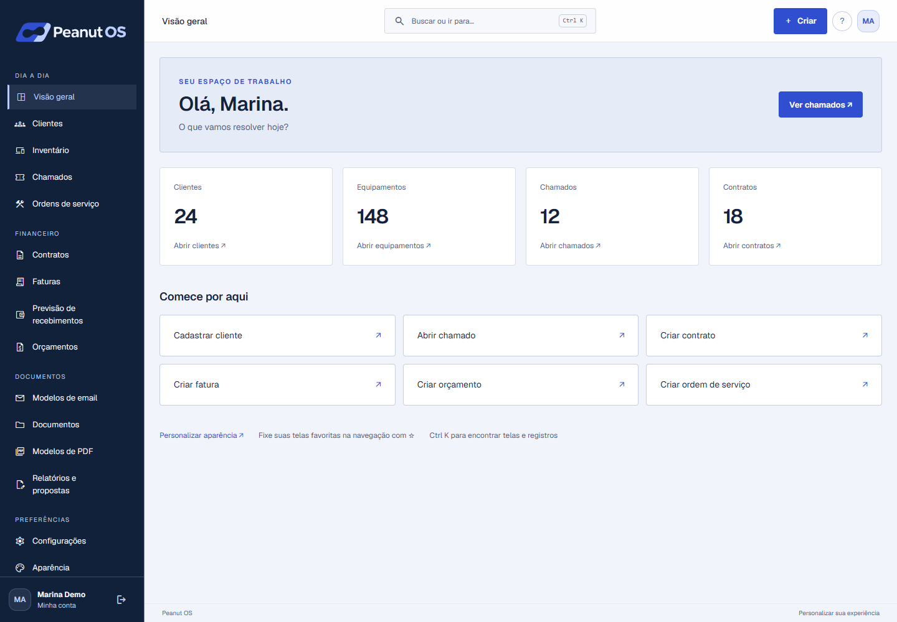
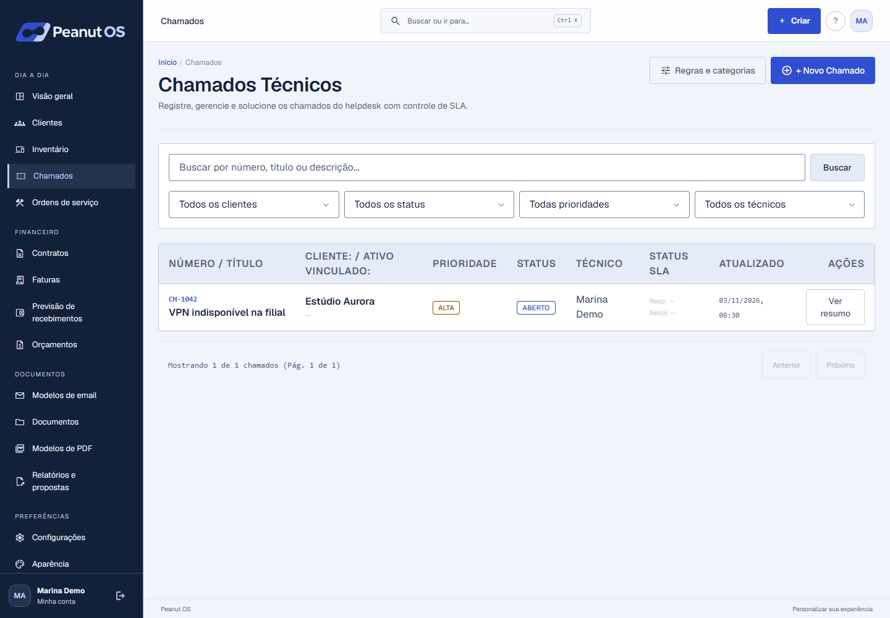
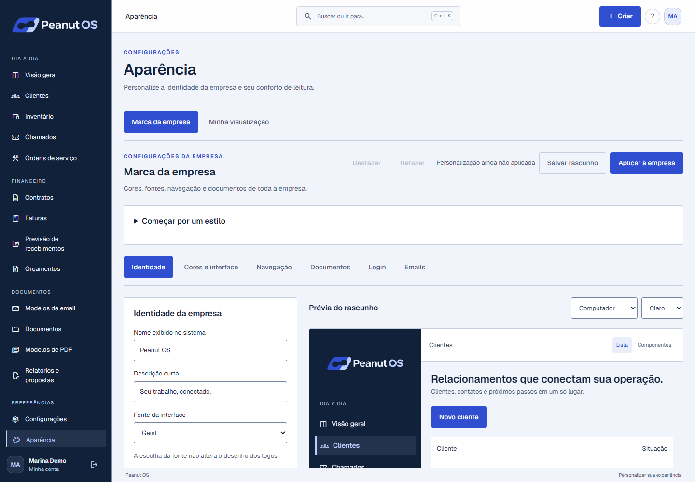
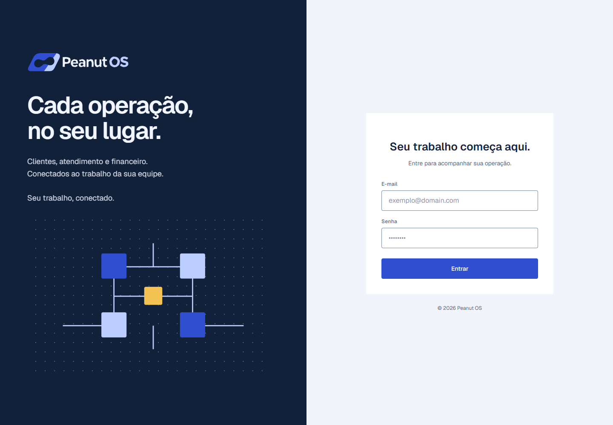

  <picture>
    <source media="(prefers-color-scheme: dark)" srcset="docs/assets/peanut-os-logo-dark.svg">
    
  </picture>

# Peanut OS

Sistema de gestão para empresas que prestam serviços de TI.

O Peanut OS reúne clientes, equipamentos, chamados, ordens de serviço, contratos e cobranças. A ideia é ter o histórico do cliente à mão durante o atendimento e conseguir acompanhar o serviço até o faturamento.

É uma aplicação web com acesso pelo computador ou celular. Pode ser instalada em servidor próprio e receber a marca da empresa que vai usá-la.

*As telas deste README usam dados fictícios.*

## O que dá para fazer

- **Clientes:** cadastrar empresas e contatos, consultar equipamentos e acompanhar os serviços relacionados a cada cliente.
- **Inventário:** registrar ativos, responsáveis e informações técnicas, com importação de dados por CSV.
- **Atendimento:** abrir chamados, definir prioridade e SLA, trocar comentários e apontar o tempo trabalhado.
- **Ordens de serviço:** organizar responsáveis, agenda, serviços e materiais utilizados.
- **Comercial:** preparar orçamentos, contratos, propostas e relatórios, com prévia e exportação em PDF.
- **Financeiro:** manter contratos recorrentes ou pontuais, lançar adicionais por competência, emitir faturas e acompanhar a previsão de recebimentos.
- **Email:** configurar modelos de cobrança, envio por SMTP e assinatura individual dos usuários.

## Do chamado à cobrança

Um chamado pode ser vinculado ao cliente e ao equipamento atendido. O técnico consulta essas informações, registra o atendimento e aponta o tempo gasto.

Nos contratos recorrentes, cada competência tem sua própria fatura. A mensalidade e os adicionais ficam discriminados para conferência antes da emissão. O PDF e a mensagem enviados preservam as informações daquele momento.

## Com a marca da sua empresa

O white-label faz parte do sistema. Em **Aparência**, é possível trocar logos, símbolos, favicon, fontes e cores, além de ajustar a navegação, os componentes e os espaçamentos.

Login, documentos e emails também podem usar essa configuração. As imagens de apresentação e dos estados vazios podem ser substituídas ou removidas. Cada usuário mantém suas preferências de leitura e sua assinatura de email.

As mudanças podem ser salvas como rascunho e conferidas nas prévias antes de aplicar. O histórico permite recuperar uma configuração anterior.

Ver personalização e página de acesso

## Acesso e uso no dia a dia

Há perfis de proprietário, administrador, financeiro, técnico e consulta, com permissões diferentes. Os dados e arquivos são separados por empresa.

A interface tem temas claro e escuro, busca global por `Ctrl K`, páginas favoritas e ajustes de contraste, densidade e tamanho de texto.

## Tecnologias

O projeto usa **TypeScript** em um monorepo com **Next.js e React** no frontend, **NestJS e Fastify** na API e **PostgreSQL com Prisma** no banco. Redis e BullMQ cuidam das tarefas em segundo plano; os PDFs são gerados com Playwright.

A instalação usa Docker. API e worker compartilham o armazenamento dos documentos, e os webhooks permitem conectar o sistema a outras ferramentas.

## Instalação e documentação

- [Preparar o ambiente e executar o projeto](docs/DEVELOPMENT.md)
- [Arquitetura](docs/architecture/overview.md)
- [Instalar com Docker](docs/deployment/production-docker.md)
- [Atualizar pelo Portainer](docs/deployment/portainer-update.md)
- [Personalização da aparência](docs/product/circuito-production.md)

O projeto continua em desenvolvimento. Envio de email e serviços externos precisam ser configurados na instalação.
