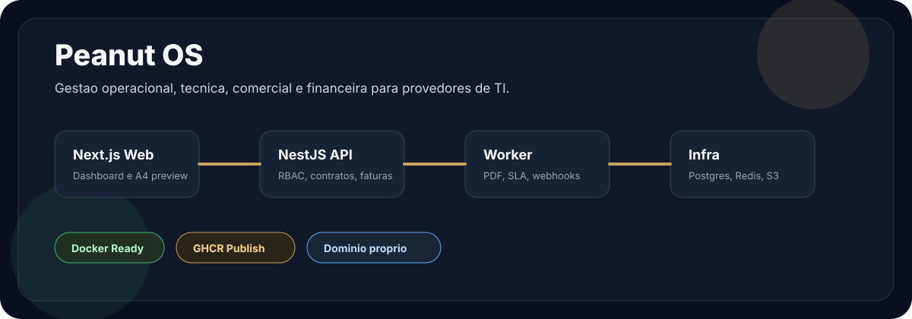
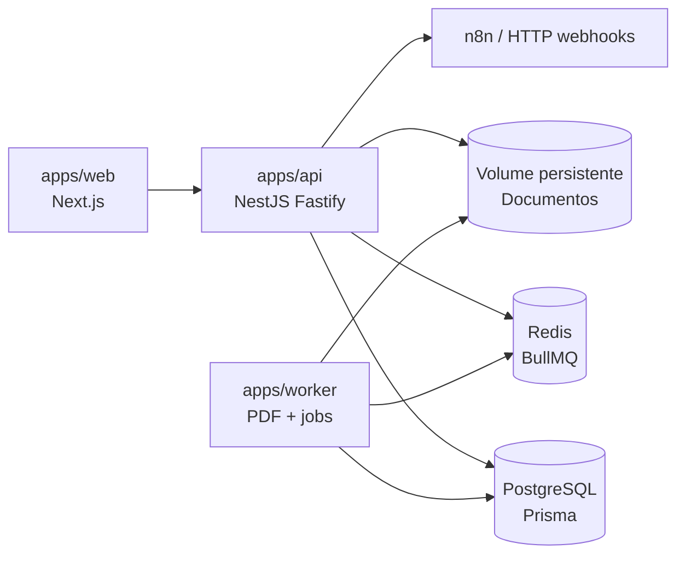
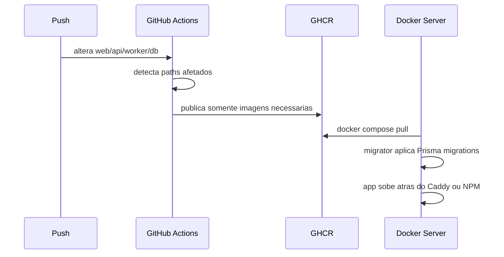

# Peanut OS

[](https://nextjs.org/)
[](https://nestjs.com/)
[](https://www.prisma.io/)
[](docs/deployment/production-docker.md)
[](.github/workflows/publish-images.yml)
[](https://pnpm.io/)



Peanut OS e uma plataforma web para gestao operacional de prestadores de servicos de TI. O projeto combina CRM tecnico, contratos, faturas, orcamentos, ordens de servico, inventario, documentos A4, webhooks e filas de background em um monorepo TypeScript.

> [!NOTE]
> Estado atual: MVP funcional em evolucao, com setup local, imagens Docker de producao e publicacao automatica via GitHub Actions.

## O que ja existe

| Area | Estado | Destaques |
| --- | --- | --- |
| Autenticacao e RBAC | Implementado | Setup inicial, login JWT, perfis `OWNER`, `ADMIN`, `FINANCIAL`, `TECHNICIAN`, `READ_ONLY` |
| Clientes | Implementado | Cadastro, contatos, status, detalhes e relacionamento com contratos/chamados |
| Inventario | Implementado | Ativos, atribuicoes, dados sensiveis criptografados e auditoria |
| Chamados | Implementado | SLA, comentarios, apontamento de tempo, categorias e politicas configuraveis |
| Contratos | Implementado | Mensalidade fixa, adicionais por competencia, emissao agendada e email SMTP |
| Faturas | Implementado | Itens editaveis antes da emissao, custos internos, preview A4 e PDF |
| Orcamentos | Implementado | Servicos, materiais, custo/venda, status, preview e PDF |
| Ordens de servico | Implementado | Fluxo operacional, responsavel, agenda, itens e PDF |
| Documentos | Implementado | Central com upload manual, volume persistente privado, filtros e downloads |
| Webhooks | Implementado | Eventos assinados, disparo por filas e gatilhos configuraveis |
| Deploy | Implementado | Dockerfile multi-target, Compose de producao, Caddy, NGINX Proxy Manager e GHCR |

## Arquitetura



## Monorepo

```txt
peanutos/
|-- apps/
|   |-- web/              # Next.js dashboard
|   |-- api/              # NestJS modular monolith
|   `-- worker/           # BullMQ, PDF, SLA, webhooks
|-- packages/
|   |-- db/               # Prisma schema, migrations, seed
|   |-- documents/        # Templates HTML/A4 e renderizacao PDF
|   |-- types/            # Tipos compartilhados
|   |-- ui/               # Componentes React compartilhados
|   |-- utils/            # Formatadores e criptografia
|   `-- validators/       # Schemas Zod
|-- infra/
|   |-- docker/           # Compose local/producao e Dockerfile
|   |-- caddy/            # Reverse proxy TLS para dominio proprio
|   `-- nginx/            # Referencia local antiga
`-- docs/
    |-- deployment/       # Guias de deploy
    `-- architecture/     # Notas de arquitetura
```

## Stack

| Camada | Tecnologia |
| --- | --- |
| Frontend | Next.js 14, React 18, Tailwind CSS |
| Backend | NestJS 10, Fastify |
| Banco | PostgreSQL 16, Prisma 5 |
| Filas | Redis 7, BullMQ |
| PDFs | Playwright Chromium |
| Storage | Filesystem privado compartilhado entre API e worker |
| Monorepo | pnpm workspaces, Turborepo |
| Deploy | Docker, GHCR, Caddy ou NGINX Proxy Manager |

## Comecar localmente

Pre-requisitos:

| Ferramenta | Versao sugerida |
| --- | --- |
| Node.js | 20 LTS |
| pnpm | 9.1.1 |
| Docker Desktop | Atual |

```powershell
cd C:\Github\peanutos
cp .env.example .env
pnpm install
docker compose -f infra\docker\docker-compose.yml up -d
pnpm db:generate
pnpm db:migrate
pnpm dev
```

URLs locais:

| Servico | URL |
| --- | --- |
| Web | http://localhost:3000 |
| API | http://localhost:3001/api/v1 |

> [!TIP]
> Em banco zerado, o app redireciona para `/setup` para criar o primeiro workspace e usuario administrador.

## Comandos uteis

| Comando | Uso |
| --- | --- |
| `pnpm dev` | Sobe web, API, worker e packages em watch mode |
| `pnpm build` | Build completo do monorepo |
| `pnpm test:storage-timezone` | Regressao de arquivos, migracao e fuso (apos compilar API, worker e packages) |
| `pnpm db:generate` | Gera Prisma Client |
| `pnpm db:migrate` | Aplica migrations em desenvolvimento |
| `pnpm db:migrate:deploy` | Aplica migrations em producao |
| `pnpm db:seed` | Popula dados ficticios de desenvolvimento |
| `docker compose -f infra\docker\docker-compose.yml up -d` | Sobe Postgres e Redis locais |
| `docker compose -f infra\docker\docker-compose.yml down -v` | Zera banco e Redis locais |

## Deploy online

O projeto ja inclui:

| Arquivo | Funcao |
| --- | --- |
| [`infra/docker/Dockerfile`](infra/docker/Dockerfile) | Dockerfile multi-target para `web`, `api`, `worker` e `migrator` |
| [`infra/docker/docker-compose.production.yml`](infra/docker/docker-compose.production.yml) | Stack self-hosted com app, Postgres, Redis, volume de arquivos e Caddy |
| [`infra/docker/docker-compose.npm.yml`](infra/docker/docker-compose.npm.yml) | Override para NGINX Proxy Manager, sem publicar Caddy |
| [`infra/caddy/Caddyfile`](infra/caddy/Caddyfile) | TLS automatico e proxy por dominio |
| [`.github/workflows/publish-images.yml`](.github/workflows/publish-images.yml) | Publicacao automatica no GHCR com path filtering |
| [`.env.production.example`](.env.production.example) | Template de variaveis de producao |
| [`docs/deployment/production-docker.md`](docs/deployment/production-docker.md) | Guia completo de deploy |

> [!IMPORTANT]
> As imagens GHCR deste repo ficam em `ghcr.io/borges-br/peanutos/<servico>`. Em producao, configure `PEANUT_IMAGE_NAMESPACE=borges-br/peanutos`; usar apenas `borges-br` faz o Docker procurar imagens no caminho errado.

Resumo do fluxo:



Leia o guia: [Deploy de producao com Docker](docs/deployment/production-docker.md).
Para uma instalação existente pelo Git, siga também o [roteiro de atualização no Portainer](docs/deployment/portainer-update.md), incluindo a migração dos arquivos antes do redeploy.

## Variaveis principais

| Grupo | Variaveis |
| --- | --- |
| Marca, fuso, SMTP e operação | Configurações pela interface, persistidas no banco |
| URLs | `NEXT_PUBLIC_WEB_URL`, `NEXT_PUBLIC_API_URL`, `CORS_ORIGIN` |
| Banco | `DATABASE_URL`, `POSTGRES_USER`, `POSTGRES_PASSWORD`, `POSTGRES_DB` |
| Cache/Fila | `REDIS_HOST`, `REDIS_PORT`, `REDIS_PASSWORD` |
| Seguranca | `JWT_SECRET`, `APP_ENCRYPTION_KEY`, `WEBHOOK_ENCRYPTION_KEY` |
| Storage | `STORAGE_PATH` (caminho absoluto; volume compartilhado em producao) |
| Worker | `PDF_MAX_CONCURRENCY`, `WEBHOOK_MAX_CONCURRENCY` |

## Arquivos existentes e fuso horario

Antes de atualizar uma instalacao com arquivos, siga o [guia de preservacao e migracao](docs/deployment/storage-migration.md). A migracao verifica tamanho e SHA-256 e preserva IDs, links, buckets e chaves. Em desenvolvimento, os arquivos ficam em `data/storage`; em Docker, no volume `peanut_storage_data`, compartilhado entre API e worker.

O fuso horario e salvo no banco por workspace, em **Configuracoes > Geral > Fuso Horario**, com edicao por OWNER/ADMIN. Previews, PDFs novos, horarios na interface e datas das rotinas usam essa escolha. PDFs antigos e arquivos enviados manualmente conservam seu conteudo. Veja as [regras e a verificacao de fuso](docs/deployment/timezone.md).

## Contratos recorrentes

Contratos geram uma fatura por competencia, com mensalidade fixa e adicionais exclusivos do mes. Cada cobranca precisa ser conferida antes da emissao agendada e do email automatico; o WhatsApp permanece manual. Configure destinatarios e programacao na aba **Recorrencia** e ajuste os adicionais na fatura. Leia o [guia de cobranca mensal e ativacao SMTP](docs/deployment/contract-billing.md) antes de habilitar em producao.

Testes, apos compilar os packages/API/worker e o frontend:

- `pnpm test:contract-billing`: regras e SMTP de captura local.
- `pnpm test:contract-billing:postgres`: migrations e concorrencia em PostgreSQL temporario (requer Docker e a imagem `postgres:16-alpine`).
- `pnpm test:contract-billing:ui`: formularios com API ficticia em navegador headless.
- `pnpm test:contract-billing:pdf`: PDFs ficticios para conferir layout e quebra de paginas.

## Seguranca

> [!IMPORTANT]
> Nunca versionar `.env`, senhas, tokens, chaves reais, dados de clientes ou PDFs reais.

> [!WARNING]
> `pnpm db:seed` e apenas para desenvolvimento. Nao rode seed em producao.

Boas praticas do projeto:

- White-label: usar variaveis de ambiente e configuracoes de workspace para marca.
- RBAC: preservar verificacoes de perfil em APIs e telas sensiveis.
- Auditoria: registrar acoes relevantes, principalmente dados sensiveis, documentos e status financeiros.
- Documentos: PDFs gerados devem ser imutaveis e versionados no storage.

## Links internos

| Documento | Link |
| --- | --- |
| Arquitetura | [`docs/architecture/overview.md`](docs/architecture/overview.md) |
| Deploy Docker | [`docs/deployment/production-docker.md`](docs/deployment/production-docker.md) |
| Handoff tecnico | [`docs/ai-handoff/`](docs/ai-handoff/) |
| Compose local | [`infra/docker/docker-compose.yml`](infra/docker/docker-compose.yml) |
| Compose producao | [`infra/docker/docker-compose.production.yml`](infra/docker/docker-compose.production.yml) |
| Compose NPM | [`infra/docker/docker-compose.npm.yml`](infra/docker/docker-compose.npm.yml) |

## Licenca

Projeto privado em desenvolvimento.

SMTP, duração da sessão, prazos de alertas e limites de webhooks são administrados em **Configurações > Integrações / Operação**. Senhas ficam criptografadas por workspace. Antes de remover variáveis de uma instalação antiga, siga o [guia de migração das configurações](docs/deployment/workspace-settings.md).
