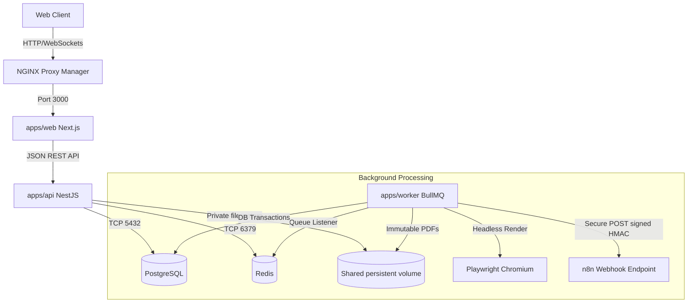

# Peanut OS — Architectural Overview

This document describes the high-level system architecture, data flow pipelines, and physical service layouts of **Peanut OS**.

## Service Responsibilities

### `apps/web` (Next.js 14)
- **Role**: Single Point of Access for administrators and technician staff.
- **Key Features**: Responsive layouts, live Ticket dashboard, Asset visual indicators, billing PDF viewers.
- **Imports**: Leverages `@peanut/ui` for styled React components and `@peanut/validators` for matching client-side schemas.

### `apps/api` (NestJS Modular Monolith)
- **Role**: Main commercial engine and validation gatekeeper.
- **Key Features**: Leverages Fastify for high-throughput REST APIs, integrates Guards for Role-Based Access Control, manages DB operations.
- **Imports**: Directly consumes `@peanut/db` client and `@peanut/utils` for encryption and private object storage.

### `apps/worker` (BullMQ Daemon)
- **Role**: Isolated asynchronous processing worker.
- **Key Features**: Runs Playwright headless Chromium for compiling print-ready A4 PDFs (Quotes, Invoices, Closures), executes Outbox dispatch webhook deliveries to external automated pipelines (n8n).

---

## Technical Guardrails

1. **Transactional Outbox Pattern**: Webhook dispatches are never sent synchronously during client requests. A business operation saves an `OutboxEvent` in the same database transaction as the entity mutation, which is then picked up asynchronously by the BullMQ worker.
2. **Immutable Document Store**: Generated commercial documents (Invoices, Quotes) are never overwritten. A new version of the document is generated as a `GeneratedDocument` linked to a new UUID key in the shared private filesystem, preserving the historical snapshot.
3. **Application-Level Cryptographic Envelope**: Highly sensitive columns (such as asset access details or integration tokens) must be encrypted on the API side before writing to database, protecting customer secrets in case of DB read leaks.

## Storage and time zone

`LocalObjectStorage` in `@peanut/utils` is the single implementation used by uploads, authenticated file downloads, document images, previews and PDF jobs. It stores `<root>/<bucket>/<key>` and preserves existing database references. Writes publish atomically without overwriting existing files. API and worker must mount the same persistent filesystem. Filesystem permissions restrict access; HTTP access stays behind the API guards. Multiple hosts require a genuinely shared filesystem or a future object-storage adapter.

`Workspace.timeZone` is the source of truth, edited by OWNER/ADMIN through Settings > General. API previews and workers read it from the database; authenticated sessions expose it for frontend formatting. UTC timestamps remain UTC in the database and webhook payloads. Date-only fields preserve their calendar date. Emission metadata records the selected zone; historical PDFs remain immutable.
