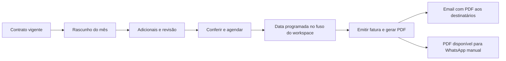

# Cobrança mensal dos contratos

## Fluxo implementado

Cada contrato recorrente ativo pode originar uma fatura por competência (`AAAA-MM`). A fatura contém os itens fixos da mensalidade e os serviços/materiais adicionais **somente daquele mês**. Os adicionais não são copiados para a competência seguinte nem alteram o contrato. Chamado e O.S. são vínculos opcionais, validados contra o mesmo cliente e workspace.

O worker prepara o mês vigente em rascunho. Também é possível preparar uma competência futura na aba **Contrato > Recorrência**. A pessoa responsável inclui adicionais, confere a prévia e usa **Conferir e agendar**. Toda edição posterior do rascunho desfaz essa conferência.

Com emissão e email automáticos ativados no contrato, o fluxo é:

Nenhum contrato antigo é ativado para emissão ou email automático pela migração. As duas opções começam desativadas. A aprovação é individual por competência: sem conferência, a cobrança fica em rascunho.

## Regras comerciais

- A mensalidade cadastrada é o valor fixo acordado. Sem itens recorrentes detalhados, vira uma linha de mensalidade. Se houver itens fixos detalhados, sua soma precisa coincidir com a mensalidade antes de preparar o mês.
- Os valores fixos são copiados para a fatura, identificados como mensalidade e protegidos na edição de itens. Alterar o contrato não muda competências já preparadas. **Atualizar mensalidade do contrato**, na fatura em rascunho, permite recopiá-los explicitamente, preservando os adicionais e exigindo nova conferência.
- Quantidades e preços aceitam até duas casas decimais. Totais e descontos são recalculados no servidor com `Prisma.Decimal`. Custos de materiais permanecem internos.
- A emissão e o vencimento têm dias separados. Dias 29–31 são limitados ao último dia do mês. Se o vencimento preceder a emissão, ele passa ao mês seguinte. A primeira emissão não antecede o início do contrato.
- A cobrança precisa pertencer à vigência contratual. Suspensão, cancelamento ou término de vigência impedem a emissão automática. Não há renovação contratual, reajuste ou cobrança proporcional automáticos nesta versão. O primeiro mês pode ser ajustado por desconto explícito antes da conferência.
- A periodicidade financeira deste fluxo é mensal. O campo legado de modalidade de renovação não transforma a cobrança em anual; renovação da vigência e frequência de faturamento são conceitos separados.
- Faturas emitidas têm conteúdo protegido. O primeiro conjunto de dados usado para gerar o PDF é congelado, inclusive em jobs concorrentes. Novas prévias e regenerações usam esse mesmo conteúdo.
- Uma competência cancelada/ignorada não é recriada pelo worker. Previsões antigas já marcadas como faturadas, mas sem referência à fatura, exigem revisão manual antes de qualquer nova cobrança.
- O sistema não associa automaticamente faturas históricas manuais às novas competências. Antes de habilitar a automação, confira o último mês já faturado e prepare o primeiro mês ainda não cobrado. Rascunhos não conferidos não serão enviados.

## Ativação no servidor

1. Preserve banco e arquivos conforme o [guia de armazenamento](storage-migration.md). Publique/construa as imagens novas de API, worker, web e migrator com a mesma versão. O runtime agora exige Node.js 20 ou superior, conforme as imagens Docker existentes.
2. Aplique as migrations antes de iniciar os novos processos. A migration `20261027010000_contract_monthly_billing` adiciona configuração financeira, vínculo fatura/competência, classificação dos itens, fontes opcionais e controle do envio. Dados antigos são preservados.
3. Confirme o volume de arquivos compartilhado, PostgreSQL, Redis, Chromium/Playwright e o worker. Além das filas existentes, passa a existir `contract-billing`, consultada a cada minuto. Os alertas usam o intervalo definido em Configurações > Operação; as operações são idempotentes.
4. Aplique também a migration `20261027020000_workspace_operational_settings`. Configure servidor, porta, TLS, usuário, senha e remetente em **Configurações > Integrações > Servidor de email (SMTP)**. Somente OWNER/ADMIN podem acessar. API e worker precisam da mesma chave mestra `APP_ENCRYPTION_KEY`. Na porta 587 use STARTTLS; na 465 use TLS direto. Certificados inválidos não são liberados. O remetente/domínio precisam estar autorizados pelo provedor. Salve e teste a conexão: o teste não envia mensagem nem comprova entrega. Depois, ative o envio. As alterações valem para os próximos processamentos, sem reiniciar. Para credenciais antigas, siga o [guia de importação](workspace-settings.md).

5. Em **Configurações > Geral**, confira o fuso. A data e o horário programados usam esse valor do banco; não há variável de ambiente de fuso.
6. No contrato, abra **Recorrência**, ajuste mensalidade, vencimento, dia/horário de emissão, pagamento e destinatários do financeiro/diretores. Ative as opções desejadas. Salve antes de preparar a competência.
7. Prepare o mês. Abra a fatura, inclua os adicionais na aba **Itens**, com chamado/O.S. se fizer sentido. Revise descontos, destinatários, vencimento e PDF. Salve e confira/agende. Uma data já passada permite emissão na próxima execução do worker, sinalizada na interface.
8. Homologue primeiro com um contrato e destinatários internos de teste. Confira a aceitação SMTP, os bytes do anexo, a competência, os valores e o vencimento. Só depois configure os destinatários reais. Não execute testes com a lista real de clientes.

## Email e WhatsApp

O email só é processado após emissão, geração e verificação do PDF da própria fatura. Os destinatários são copiados para a competência e podem ser revistos antes da emissão. Mudanças no cadastro do contrato não substituem silenciosamente a lista de um mês já preparado.

| Situação na interface | Significado e ação |
| --- | --- |
| SMTP desativado ou indisponível | Envios pausados sem consumir tentativas. Confira configuração e chave mestra; ao ativar, pendências elegíveis voltam ao processamento. |
| Envio manual | Email automático não solicitado. |
| Aguardando PDF/envio | Emissão aprovada; aguarda o PDF ou o próximo processamento. |
| Enviando | O worker assumiu o envio. Cancelamento da fatura aguarda a conclusão. |
| Aceito pelo servidor SMTP | O servidor aceitou os destinatários. Isso não comprova leitura nem entrega na caixa de entrada. |
| Aceitação parcial | Alguns destinatários foram recusados. A nova tentativa atende somente os ainda não aceitos. |
| Falha no envio | Erro conhecido antes da aceitação. Até cinco tentativas, com intervalo de cinco minutos; depois requer ação. |
| Confirmação pendente | A conexão/processo terminou sem confirmação do resultado. Não há repetição automática; confira a caixa de saída antes de confirmar o reenvio. |

O sistema não promete entrega exatamente uma vez por SMTP. Ele grava a tentativa antes da transmissão, usa identificador estável e evita repetir envios cujo resultado ficou incerto. Desativar o email pausa tentativas futuras; uma mensagem já aceita pelo servidor não pode ser recolhida por esse fluxo.

Na fatura, **Atualizar situação** recarrega o resultado. Para WhatsApp, baixe o PDF na prévia e anexe manualmente. Os contatos configurados permitem abrir a conversa com uma mensagem sugerida; o aplicativo não envia o anexo ou a mensagem pelo WhatsApp automaticamente.

## Falhas e recuperação

- **SMTP ausente:** a fatura/PDF ficam disponíveis e o envio registra falha de configuração. Configure o worker e acompanhe a próxima tentativa.
- **PDF indisponível:** o email aguarda o documento. Confira a fila/logs do worker; após corrigir armazenamento ou Chromium, gere o PDF na prévia. Não substitua o anexo por um arquivo de outra cobrança.
- **Itens fixos divergentes:** ajuste os itens recorrentes e a mensalidade do contrato. Os avulsos pertencem à fatura do mês.
- **Contrato encerrado com fechamento pendente:** revise o período e o fechamento; o sistema não emite automaticamente fora da vigência nem prorroga o contrato sozinho.
- **Email incerto:** verifique a caixa de saída e o provedor antes de usar **Nova tentativa de email**. Não altere estados diretamente no banco para contornar a conferência.
- **Backup/rollback:** banco e arquivos precisam ser preservados juntos. Pare os workers antes de voltar uma versão para evitar emissores concorrentes com regras diferentes.

## Validação realizada

Foram executados builds de API, worker e frontend; testes de regras com banco simulado; SMTP de captura em loopback com destinatários fictícios; migrações e testes de bloqueio/transação em PostgreSQL 16 temporário; navegação dos formulários em Chromium/Edge headless com API fictícia; e renderização/inspeção de PDFs curtos e com muitas linhas.

Esses testes não comprovam configuração do SMTP de produção, reputação do domínio, recebimento pelos destinatários reais ou implantação no servidor. Nenhuma mensagem real de cliente foi enviada e o banco do sistema não foi alterado pela validação.

Referência do transporte: [Nodemailer oficial](https://github.com/nodemailer/nodemailer).
