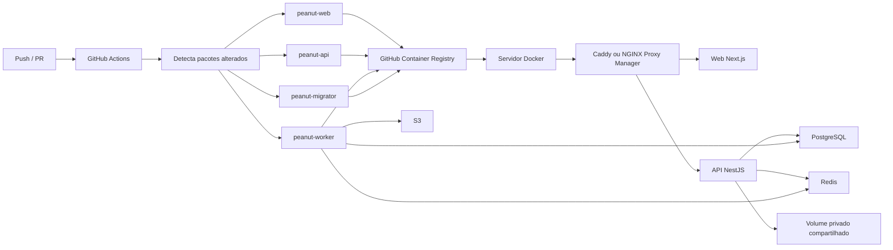

# Deploy de producao com Docker


Este guia prepara o Peanut OS para rodar online em dominio proprio, usando imagens publicadas automaticamente pelo GitHub Actions. Voce pode operar com Caddy embutido ou com NGINX Proxy Manager externo.

## Visao rapida



## Imagens publicadas

O workflow `.github/workflows/publish-images.yml` publica imagens separadas para cada parte do monorepo.

| Imagem | Docker target | Quando rebuilda | Funcao |
| --- | --- | --- | --- |
| `peanut-web` | `web` | Mudancas em `apps/web`, `packages/ui`, `packages/types`, `packages/utils`, `packages/validators` ou arquivos comuns | Interface Next.js |
| `peanut-api` | `api` | Mudancas em `apps/api`, Prisma, documentos, tipos, utils, validators ou arquivos comuns | API NestJS/Fastify |
| `peanut-worker` | `worker` | Mudancas em `apps/worker`, Prisma, documentos, tipos, utils ou arquivos comuns | Filas BullMQ, PDF e webhooks |
| `peanut-migrator` | `migrator` | Mudancas em `packages/db` ou arquivos comuns | Executa `prisma migrate deploy` |

> [!TIP]
> Em pull requests as imagens sao apenas buildadas. Em `main`, `master` ou tags `v*`, elas tambem sao publicadas no GHCR.

## Pipeline otimizado

O build evita refazer tudo a cada push por tres camadas:

| Otimizacao | Onde fica | Resultado pratico |
| --- | --- | --- |
| Path filter | `dorny/paths-filter` | So cria matrix para imagens afetadas |
| BuildKit cache | `cache-from/to: type=gha` | Reaproveita camadas Docker por servico |
| pnpm cache mount | `RUN --mount=type=cache,id=pnpm-store` | Reaproveita download de dependencias |
| Turbo filter | `pnpm turbo run build --filter=<servico>...` | Compila o app e suas dependencias reais |

## Preparar GitHub

1. Confirme que o repo pode publicar pacotes:
   - `Settings > Actions > General > Workflow permissions`
   - Marque `Read and write permissions`

2. Opcionalmente configure a variavel do repo:

| Variavel GitHub | Quando usar | Valor sugerido |
| --- | --- | --- |
| `NEXT_PUBLIC_API_URL` | API em dominio separado | `https://api.example.com/api/v1` |

Se web e API rodam no mesmo dominio via Caddy, deixe sem configurar. A imagem usa `/api/v1`.

## Preparar servidor

Requisitos:

| Recurso | Minimo sugerido |
| --- | --- |
| Docker Engine | 24+ |
| Docker Compose plugin | 2.20+ |
| CPU | 2 vCPU |
| RAM | 2 GB minimo, 4 GB recomendado |
| Disco | 20 GB+ para banco, objetos e imagens |
| DNS | Registro `A` apontando para o servidor |

No servidor:

```bash
mkdir -p /opt/peanut-os
cd /opt/peanut-os
```

Copie estes arquivos do repositorio para o servidor:

```txt
infra/docker/docker-compose.production.yml
infra/docker/docker-compose.npm.yml
infra/caddy/Caddyfile
.env.production.example
```

Depois crie o arquivo real:

```bash
cp .env.production.example .env.production
nano .env.production
```

> [!WARNING]
> Nunca use os valores `change-me` em producao. Gere segredos reais antes do primeiro `up`.

## Variaveis obrigatorias

### Dominio e imagens

| Variavel | Obrigatoria | Exemplo | Para que serve |
| --- | --- | --- | --- |
| `PEANUT_DOMAIN` | Sim | `app.example.com` | Dominio publico atendido pelo Caddy |
| `ACME_EMAIL` | Sim | `admin@example.com` | E-mail usado pelo Let's Encrypt |
| `NEXT_PUBLIC_WEB_URL` | Sim | `https://app.example.com` | URL publica da interface |
| `NEXT_PUBLIC_API_URL` | Sim | `/api/v1` | URL que o browser usa para chamar a API |
| `CORS_ORIGIN` | Sim | `https://app.example.com` | Origem aceita pela API |
| `PEANUT_IMAGE_REGISTRY` | Sim | `ghcr.io` | Registry Docker |
| `PEANUT_IMAGE_NAMESPACE` | Sim | `borges-br/peanutos` | Namespace das imagens no GHCR, sempre com `owner/repository` |
| `PEANUT_IMAGE_TAG` | Sim | `latest` ou `sha-abc123` | Tag que o Compose deve baixar |
| `NPM_NETWORK` | So NPM | `npm_proxy` | Rede Docker externa compartilhada com o NGINX Proxy Manager |

> [!IMPORTANT]
> O namespace precisa incluir o nome do repositorio. Para este projeto, use `PEANUT_IMAGE_NAMESPACE=borges-br/peanutos`. Se usar apenas `borges-br`, o Docker tentara baixar `ghcr.io/borges-br/peanut-web:latest`, que nao e o caminho publicado pelo workflow.

## Escolher proxy reverso

| Modo | Use quando | Arquivos Compose | Portas 80/443 |
| --- | --- | --- | --- |
| Caddy | O Peanut OS deve gerenciar TLS e proxy sozinho | `docker-compose.production.yml` | Publicadas pelo `peanut-caddy` |
| NGINX Proxy Manager | Voce ja usa NPM para dominios e certificados | `docker-compose.production.yml` + `docker-compose.npm.yml` | Continuam com o NPM |

> [!TIP]
> Nos dois modos, mantenha `NEXT_PUBLIC_API_URL=/api/v1`. Isso deixa web e API no mesmo dominio e simplifica CORS.

### Banco e cache

| Variavel | Obrigatoria | Exemplo | Para que serve |
| --- | --- | --- | --- |
| `POSTGRES_USER` | Sim | `peanut_user` | Usuario do PostgreSQL |
| `POSTGRES_PASSWORD` | Sim | `use-um-segredo-forte` | Senha do PostgreSQL |
| `POSTGRES_DB` | Sim | `peanut_db` | Banco principal |
| `REDIS_PASSWORD` | Sim | `use-um-segredo-forte` | Senha do Redis/BullMQ |

> [!IMPORTANT]
> Se a senha do Postgres tiver `@`, `:`, `/`, `?` ou `#`, use uma senha URL-safe ou edite `DATABASE_URL` manualmente com a senha codificada.

### Seguranca

| Variavel | Obrigatoria | Exemplo | Para que serve |
| --- | --- | --- | --- |
| `JWT_SECRET` | Sim | 32+ caracteres aleatorios | Assinatura do access token |
| `APP_ENCRYPTION_KEY` | Sim | base64 de 32 bytes | Criptografia de dados sensiveis |
| `APPLICATION_ENCRYPTION_KEY` | Temporaria | hex de 64 chars | Compatibilidade com rotinas existentes |
| `WEBHOOK_ENCRYPTION_KEY` | Sim | 32+ caracteres | Protecao de segredos de webhook |

Gerar chave de criptografia:

```bash
node -e "console.log(require('crypto').randomBytes(32).toString('base64'))"
```

### Arquivos e PDF

| Variavel | Obrigatoria | Exemplo | Para que serve |
| --- | --- | --- | --- |
| `STORAGE_PATH` | Sim, definido no Compose | `/data/storage` | Volume persistente compartilhado entre API e worker |
| `PDF_MAX_CONCURRENCY` | Opcional | `1` | Concorrencia do worker de PDF |
| `API_BODY_LIMIT_BYTES` | Opcional | `26214400` | Limite de upload JSON/base64 |

### Configurações operacionais

SMTP (incluindo usuário e senha), duração da sessão, prazos de alertas, intervalo de verificação e limites de webhooks são gerenciados pela interface e persistidos no banco. Mantenha as chaves mestras em API e worker e preserve-as nos backups. A migração de configurações existentes está no [guia de configurações](workspace-settings.md).

## Primeiro deploy com Caddy

1. Login no GHCR:

```bash
docker login ghcr.io
```

Se o pacote GHCR estiver privado, use um Personal Access Token com permissao `read:packages`:

```bash
echo "$GHCR_PAT" | docker login ghcr.io -u SEU_USUARIO --password-stdin
```

> [!IMPORTANT]
> Se o deploy for feito pelo Portainer, configure tambem o registry dentro do Portainer. O `docker login` feito no terminal pode nao ser usado pela stack quando o pull e disparado pela interface.

### Portainer + GHCR privado

Se os packages estiverem privados no GitHub Container Registry:

1. Crie um Personal Access Token no GitHub com permissao `read:packages`.
2. No Portainer, adicione um registry:

| Campo | Valor |
| --- | --- |
| Registry type | Custom registry |
| Name | `ghcr.io` |
| Registry URL | `ghcr.io` |
| Username | Seu usuario GitHub |
| Password | PAT com `read:packages` |

3. No deploy da stack, selecione esse registry/autenticacao para que o Portainer consiga puxar `ghcr.io/borges-br/peanutos/*`.

Alternativa simples: tornar os packages publicos no GitHub em `Packages > Package settings > Change visibility > Public`.

2. Baixar imagens:

```bash
docker compose --env-file .env.production -f infra/docker/docker-compose.production.yml pull
```

3. Subir aplicacao:

```bash
docker compose --env-file .env.production -f infra/docker/docker-compose.production.yml up -d
```

O servico `migrator` roda automaticamente como um job de inicializacao. Ele aplica as migracoes pendentes, encerra com status `0`, e so entao `peanut-api` e `peanut-worker` iniciam. E normal ele aparecer como `Exited` no Docker/Portainer depois do deploy.

4. Validar:

```bash
docker compose --env-file .env.production -f infra/docker/docker-compose.production.yml ps
curl https://app.example.com/api/v1/health
```

## Primeiro deploy com NGINX Proxy Manager

Use este modo se o NPM ja esta publicado nas portas `80` e `443` do servidor.

1. Criar uma rede compartilhada com o NPM:

```bash
docker network create npm_proxy
docker network connect npm_proxy <nome-do-container-do-npm>
```

Se sua rede ja existir com outro nome, ajuste:

```env
NPM_NETWORK=nome_da_sua_rede
```

2. Baixar imagens:

```bash
docker compose --env-file .env.production \
  -f infra/docker/docker-compose.production.yml \
  -f infra/docker/docker-compose.npm.yml \
  pull
```

3. Subir aplicacao sem Caddy:

```bash
docker compose --env-file .env.production \
  -f infra/docker/docker-compose.production.yml \
  -f infra/docker/docker-compose.npm.yml \
  up -d
```

O servico `migrator` roda automaticamente como um job de inicializacao. Ele aplica as migracoes pendentes, encerra com status `0`, e so entao `peanut-api` e `peanut-worker` iniciam. E normal ele aparecer como `Exited` no Docker/Portainer depois do deploy.

4. Configurar o Proxy Host no NPM:

| Tela do NPM | Valor |
| --- | --- |
| Domain Names | `app.example.com` |
| Scheme | `http` |
| Forward Hostname / IP | `peanut-web` |
| Forward Port | `3000` |
| Websockets Support | Ativado |
| SSL Certificate | Solicitar ou selecionar certificado |
| Force SSL | Ativado |

Em `Custom locations`, adicione:

| Campo | Valor |
| --- | --- |
| Location | `/api/v1` |
| Scheme | `http` |
| Forward Hostname / IP | `peanut-api` |
| Forward Port | `3001` |

5. Validar:

```bash
curl https://app.example.com/api/v1/health
```

## Atualizar producao

### Caddy

```bash
docker compose --env-file .env.production -f infra/docker/docker-compose.production.yml pull
docker compose --env-file .env.production -f infra/docker/docker-compose.production.yml up -d
docker image prune -f
```

### NGINX Proxy Manager

```bash
docker compose --env-file .env.production \
  -f infra/docker/docker-compose.production.yml \
  -f infra/docker/docker-compose.npm.yml \
  pull
docker compose --env-file .env.production \
  -f infra/docker/docker-compose.production.yml \
  -f infra/docker/docker-compose.npm.yml \
  up -d
docker image prune -f
```

## Build local de imagens

```bash
docker buildx build -f infra/docker/Dockerfile --target web -t peanut-web:local .
docker buildx build -f infra/docker/Dockerfile --target api -t peanut-api:local .
docker buildx build -f infra/docker/Dockerfile --target worker -t peanut-worker:local .
docker buildx build -f infra/docker/Dockerfile --target migrator -t peanut-migrator:local .
```

Para web com API em dominio separado:

```bash
docker buildx build \
  -f infra/docker/Dockerfile \
  --target web \
  --build-arg NEXT_PUBLIC_API_URL=https://api.example.com/api/v1 \
  -t peanut-web:local .
```

## Preservacao e atualizacao com arquivos existentes

Siga o [guia de preservacao e migracao](storage-migration.md) **antes** de atualizar uma instalacao que usava armazenamento antigo. O novo Compose dispensa esse servico e monta `peanut_storage_data` em `/data/storage` na API e no worker. Os arquivos antigos precisam ser copiados e verificados antes de reabrir o sistema.

Volumes persistem entre recriacoes de containers. Nao use `down -v`, `docker volume prune` nem exclua volumes no Portainer ao atualizar. Para parar a stack mantendo os dados, use `docker compose ... stop` ou `down` sem a opcao de volumes. Backup precisa incluir banco e arquivos, no mesmo ponto de consistencia.

O volume novo e inicializado para o usuario `node` (UID 1000) pelas imagens. Se um volume foi populado por ferramentas executadas como root, corrija a propriedade para `1000:1000` antes de iniciar API e worker. Nao publique o diretorio via Caddy/NPM: o acesso passa pelos endpoints autenticados.

## Fuso horario

Configure em **Configuracoes > Geral > Fuso Horario** com OWNER/ADMIN. O valor e salvo no banco por workspace; nao existe variavel de ambiente para sobrescreve-lo. Atualize o banco com o migrator antes de subir as novas imagens. O padrao inicial e `America/Sao_Paulo`.

O worker consulta as configuracoes a cada emissao e varredura. O relogio tecnico consulta a fila a cada minuto em UTC; a verificacao de alertas segue o intervalo definido em Configuracoes > Operacao (padrao de 60 minutos). O dia, mes e horario de negocio sao calculados no fuso do workspace. Veja [regras de datas](timezone.md).

## Cobranca mensal e email

A fila `contract-billing` consulta cobranças a cada minuto. Emissão e email automáticos começam desativados nos contratos existentes e exigem configuração e conferência por competência. O SMTP é configurado em **Configurações > Integrações**, por workspace, com senha criptografada. Consulte o [guia de cobrança mensal](contract-billing.md) para ativação, homologação e recuperação de envios.
