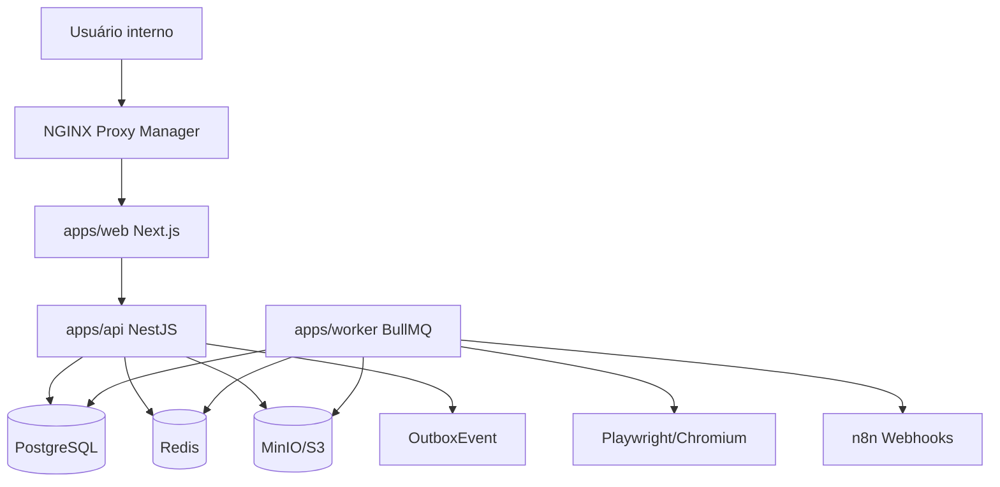
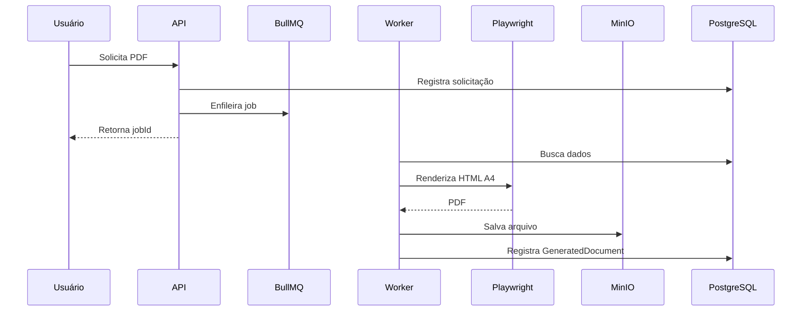
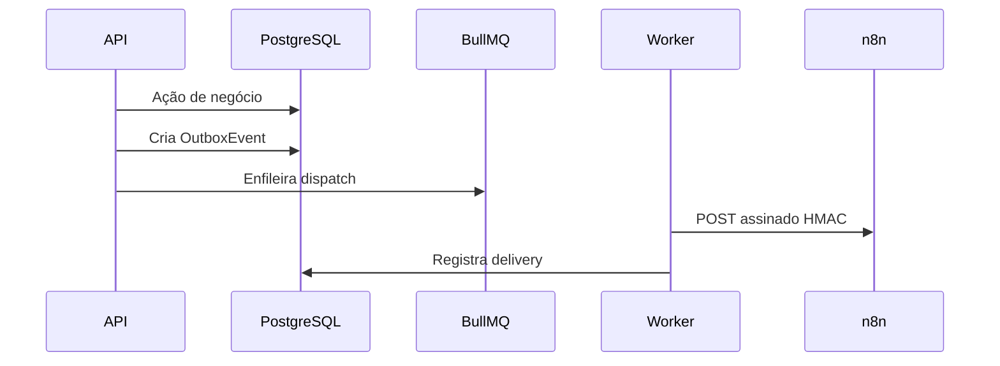

# 03 — Arquitetura Técnica

## Visão geral

Arquitetura com frontend Next.js, API NestJS, worker BullMQ, PostgreSQL, Redis e MinIO/S3.



## Serviços

| Serviço | Responsabilidade |
|---|---|
| web | Interface administrativa |
| api | Regras de negócio, autenticação, API REST |
| worker | PDFs, webhooks, jobs e importações |
| postgres | Banco relacional |
| redis | Fila e cache leve |
| minio | Arquivos, PDFs e anexos |

## Modular monolith

O backend deve ser monólito modular para reduzir complexidade operacional. Microserviços são prematuros para o MVP.

Módulos sugeridos:

```txt
auth, users, roles, clients, contacts, inventory, client-users,
contracts, quotes, invoices, tickets, documents, files,
webhooks, audit, settings, health
```

## Fluxo de PDF



## Fluxo de webhook



## Segurança base

- HTTPS.
- Cookie HTTP-only preferencial.
- RBAC.
- Auditoria.
- Rate limit.
- Storage privado.
- URLs assinadas para download.
- Secrets fora do Git.
- Logs sanitizados.

## Escalabilidade futura

Escalar primeiro workers, depois API/web. Separar PDF engine se volume crescer.
