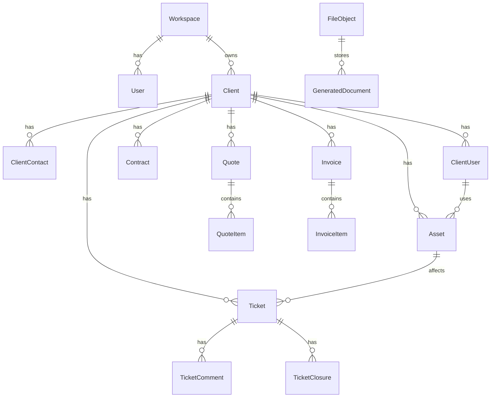

# 05 — Modelo de Dados Inicial

## Princípios

- UUID como chave primária.
- `workspaceId` nas entidades principais.
- Soft delete onde fizer sentido.
- Enums para status críticos.
- PDFs emitidos em `GeneratedDocument`.
- Arquivos em `FileObject`.
- Webhooks por outbox.
- Auditoria separada.

## Diagrama conceitual

## Entidades obrigatórias

### Workspace

- id, name, slug, status, createdAt, updatedAt.

### User

- id, workspaceId, name, email, passwordHash, role, status, lastLoginAt, createdAt, updatedAt, deletedAt.

Enums: `OWNER`, `ADMIN`, `TECHNICIAN`, `FINANCIAL`, `READ_ONLY`.

### Client

- id, workspaceId, type, legalName, tradeName, document, email, phone, website, notes, status, timestamps.

### ClientContact

- id, clientId, name, email, phone, mobile, role, department, isPrimary, notes, status.

### ClientUser

- id, clientId, fullName, email, department, jobTitle, status, primaryAssetId, folderPermissions, printerAccess, accessHours, storageQuota, notes.

### Asset

- id, workspaceId, clientId, assignedClientUserId, name, hostname, type, status, manufacturer, model, serialNumber, assetTag, macAddress, operatingSystem, location, remoteAccessId, sensitiveDataEncrypted, notes.

Enums de tipo: `WORKSTATION`, `NOTEBOOK`, `SERVER`, `PRINTER`, `ROUTER`, `SWITCH`, `ACCESS_POINT`, `CAMERA`, `NVR`, `UPS`, `RACK`, `LICENSE`, `CLOUD_SERVICE`, `VPN`, `STORAGE`, `OTHER`.

Enums de status: `OPERATIONAL`, `MAINTENANCE`, `OUT_OF_STANDARD`, `STOCK`, `RETIRED`, `SCRAPPED`, `LOST`, `PENDING_VALIDATION`.

### Ticket

- id, workspaceId, clientId, contactId, clientUserId, assetId, contractId, number, title, description, channel, priority, status, assignedToId, openedAt, firstResponseAt, startedAt, resolvedAt, closedAt, slaDueFirstResponseAt, slaDueStartAt.

### Quote / QuoteItem

- Quote: id, workspaceId, clientId, number, status, issueDate, validUntil, subtotalServices, subtotalMaterials, discountAmount, totalAmount.
- QuoteItem: id, quoteId, type, description, quantity, unit, unitPrice, totalPrice, sortOrder.

### Invoice / InvoiceItem

- Invoice: id, workspaceId, clientId, quoteId, contractId, ticketId, number, status, issueDate, dueDate, paymentMethod, pixKey, totals, paidAt.
- InvoiceItem: mesmo padrão de QuoteItem.

### Contract

- id, workspaceId, clientId, number, title, version, status, startDate, endDate, monthlyValue, billingDay, scope, includedServices, excludedServices, slaPolicyId, onsiteSupportAllowance, maxUsers, maxAssets.

### FileObject

- id, workspaceId, bucket, key, originalFilename, mimeType, sizeBytes, sha256, visibility, createdById.

### GeneratedDocument

- id, workspaceId, entityType, entityId, documentType, version, fileObjectId, sha256, generatedById, generatedAt, metadata.

### OutboxEvent / WebhookDelivery

- OutboxEvent: evento gerado pela regra de negócio.
- WebhookDelivery: tentativa de entrega para endpoint.

### AuditLog

- id, workspaceId, actorUserId, action, entityType, entityId, beforeJson, afterJson, ipAddress, userAgent, severity, createdAt.

## Índices recomendados

- `clients(workspaceId, document)`.
- `assets(workspaceId, clientId, type)`.
- `assets(clientId, status)`.
- `tickets(workspaceId, status, priority)`.
- `invoices(workspaceId, status, dueDate)`.
- `quotes(workspaceId, status, validUntil)`.
- `outbox_events(status, nextAttemptAt)`.
- `audit_logs(workspaceId, entityType, entityId)`.
