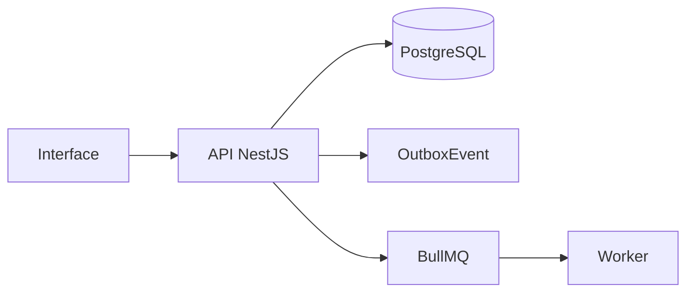

# Módulo de Inventário

## Objetivo

Controlar ativos físicos e lógicos, usuários dos clientes, histórico, status operacional e vínculo com chamados, contratos e documentação.

## Entidades principais

- Asset
- ClientUser
- AssetNetworkInfo
- AssetHistory
- CredentialReference

## Fluxo geral

## Eventos

- `asset.created`
- `asset.updated`
- `asset.status_changed`

## Regras essenciais

- Usar `workspaceId` nas entidades principais.
- Respeitar RBAC.
- Registrar auditoria em ações sensíveis.
- Usar soft delete quando aplicável.
- Evitar processamento pesado dentro da requisição HTTP.
- Não sobrescrever histórico relevante.

## Critérios de aceite

- Cadastrar ativo
- Vincular usuário
- Alterar status com histórico
- Buscar hostname/RustDesk ID
- Filtrar por cliente/tipo/status

## Endpoints esperados

A lista detalhada deve seguir `01_arquitetura/06_api_design.md`.

## Testes obrigatórios

- Validações de DTO.
- Permissões.
- Estados/status.
- Auditoria.
- Eventos outbox, quando aplicável.
- Erros controlados.
