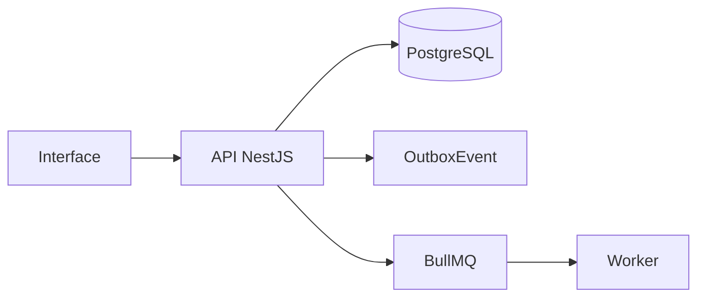

# Módulo de Orçamentos e Faturas

## Objetivo

Controlar propostas e cobranças, com cálculo de totais, status, numeração e PDF A4.

## Entidades principais

- Quote
- QuoteItem
- Invoice
- InvoiceItem
- NumberSequence
- GeneratedDocument

## Fluxo geral

## Eventos

- `quote.created`
- `quote.sent`
- `quote.accepted`
- `invoice.issued`
- `invoice.paid`
- `invoice.overdue`

## Regras essenciais

- Usar `workspaceId` nas entidades principais.
- Respeitar RBAC.
- Registrar auditoria em ações sensíveis.
- Usar soft delete quando aplicável.
- Evitar processamento pesado dentro da requisição HTTP.
- Não sobrescrever histórico relevante.

## Critérios de aceite

- Criar orçamento
- Gerar PDF
- Aceitar orçamento
- Criar fatura
- Marcar fatura paga

## Endpoints esperados

A lista detalhada deve seguir `01_arquitetura/06_api_design.md`.

## Testes obrigatórios

- Validações de DTO.
- Permissões.
- Estados/status.
- Auditoria.
- Eventos outbox, quando aplicável.
- Erros controlados.
