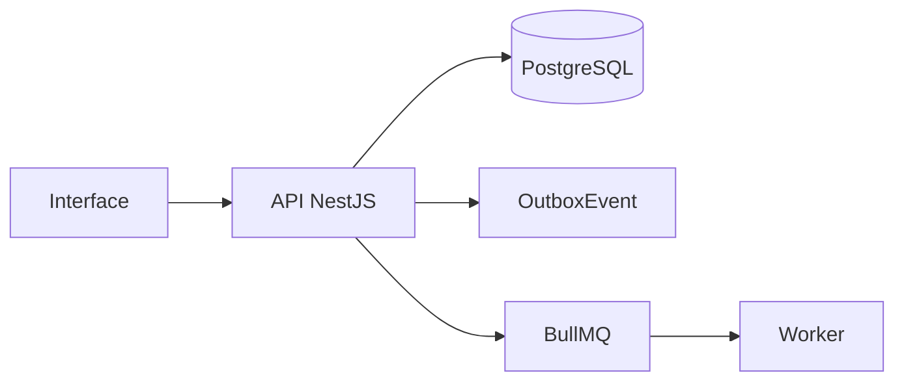

# Módulo de Chamados e SLA

## Objetivo

Registrar chamados técnicos, SLA, comentários, tempo, anexos, estados e encerramento técnico.

## Entidades principais

- Ticket
- TicketComment
- TicketTimeEntry
- TicketClosure
- SlaPolicy

## Fluxo geral

## Eventos

- `ticket.created`
- `ticket.status_changed`
- `ticket.closed`
- `ticket.sla_breached`

## Regras essenciais

- Usar `workspaceId` nas entidades principais.
- Respeitar RBAC.
- Registrar auditoria em ações sensíveis.
- Usar soft delete quando aplicável.
- Evitar processamento pesado dentro da requisição HTTP.
- Não sobrescrever histórico relevante.

## Critérios de aceite

- Abrir chamado
- Bloquear transição inválida
- Calcular SLA
- Encerrar chamado
- Gerar relatório

## Endpoints esperados

A lista detalhada deve seguir `01_arquitetura/06_api_design.md`.

## Testes obrigatórios

- Validações de DTO.
- Permissões.
- Estados/status.
- Auditoria.
- Eventos outbox, quando aplicável.
- Erros controlados.
