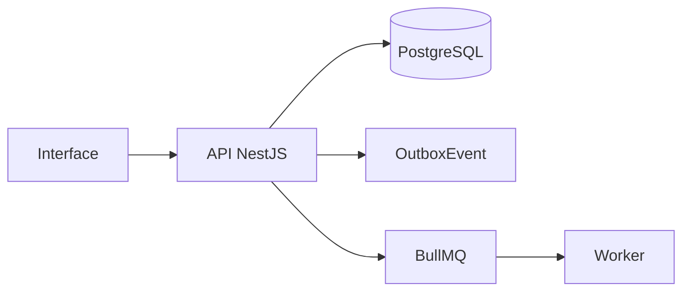

# Engine de Documentos e PDF A4

## Objetivo

Gerar documentos A4 profissionais por Playwright em worker, com snapshots imutáveis.

## Entidades principais

- Document
- DocumentVersion
- GeneratedDocument
- FileObject
- PdfJob

## Fluxo geral

## Eventos

- `document.generated`
- `document.failed`

## Regras essenciais

- Usar `workspaceId` nas entidades principais.
- Respeitar RBAC.
- Registrar auditoria em ações sensíveis.
- Usar soft delete quando aplicável.
- Evitar processamento pesado dentro da requisição HTTP.
- Não sobrescrever histórico relevante.

## Critérios de aceite

- Preview HTML
- Gerar PDF em worker
- Salvar no MinIO
- Registrar hash
- Preservar versões

## Endpoints esperados

A lista detalhada deve seguir `01_arquitetura/06_api_design.md`.

## Testes obrigatórios

- Validações de DTO.
- Permissões.
- Estados/status.
- Auditoria.
- Eventos outbox, quando aplicável.
- Erros controlados.
