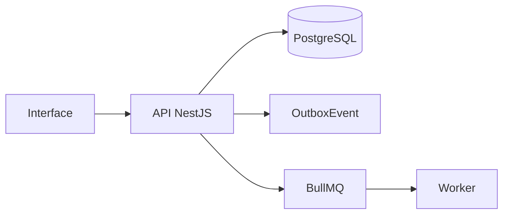

# Módulo de Contratos

## Objetivo

Controlar contratos, SLA, franquia, versionamento, recorrência e faturas mensais.

## Entidades principais

- Contract
- ContractVersion
- SlaPolicy
- ContractAllowance
- ContractCoveredAsset

## Fluxo geral

## Eventos

- `contract.created`
- `contract.activated`
- `contract.renewal_soon`
- `contract.recurring_invoice_created`

## Regras essenciais

- Usar `workspaceId` nas entidades principais.
- Respeitar RBAC.
- Registrar auditoria em ações sensíveis.
- Usar soft delete quando aplicável.
- Evitar processamento pesado dentro da requisição HTTP.
- Não sobrescrever histórico relevante.

## Critérios de aceite

- Criar contrato
- Ativar
- Versionar
- Aplicar SLA
- Gerar fatura recorrente

## Endpoints esperados

A lista detalhada deve seguir `01_arquitetura/06_api_design.md`.

## Testes obrigatórios

- Validações de DTO.
- Permissões.
- Estados/status.
- Auditoria.
- Eventos outbox, quando aplicável.
- Erros controlados.
