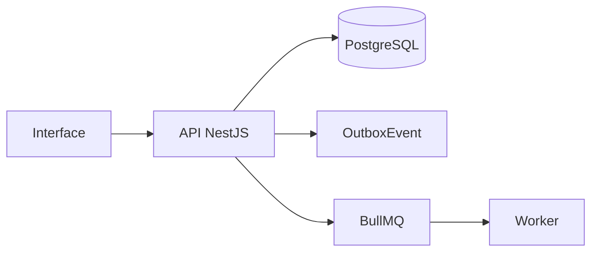

# Webhooks e n8n

## Objetivo

Enviar eventos para n8n com HMAC, outbox, retry, logs e reenvio manual.

## Entidades principais

- OutboxEvent
- WebhookEndpoint
- WebhookDelivery

## Fluxo geral

## Eventos

- `invoice.due_soon`
- `invoice.overdue`
- `ticket.created`
- `ticket.closed`
- `document.generated`

## Regras essenciais

- Usar `workspaceId` nas entidades principais.
- Respeitar RBAC.
- Registrar auditoria em ações sensíveis.
- Usar soft delete quando aplicável.
- Evitar processamento pesado dentro da requisição HTTP.
- Não sobrescrever histórico relevante.

## Critérios de aceite

- Criar endpoint
- Assinar payload
- Retry em falha
- Reenviar manualmente
- Auditar alterações

## Endpoints esperados

A lista detalhada deve seguir `01_arquitetura/06_api_design.md`.

## Testes obrigatórios

- Validações de DTO.
- Permissões.
- Estados/status.
- Auditoria.
- Eventos outbox, quando aplicável.
- Erros controlados.
